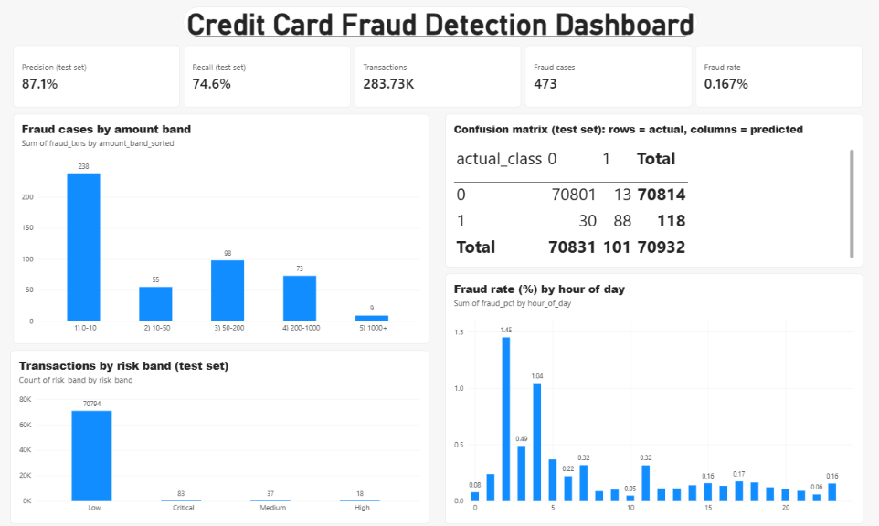
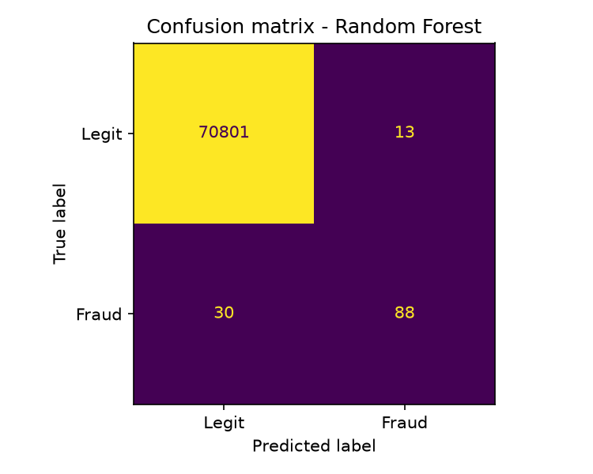
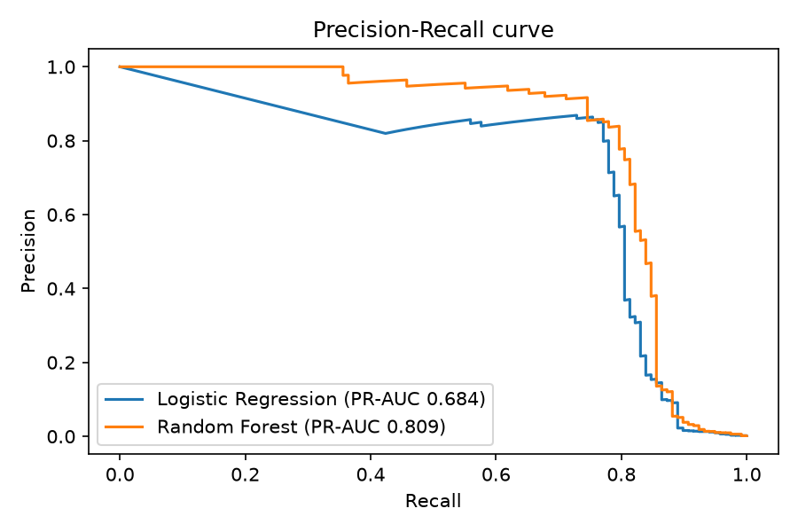
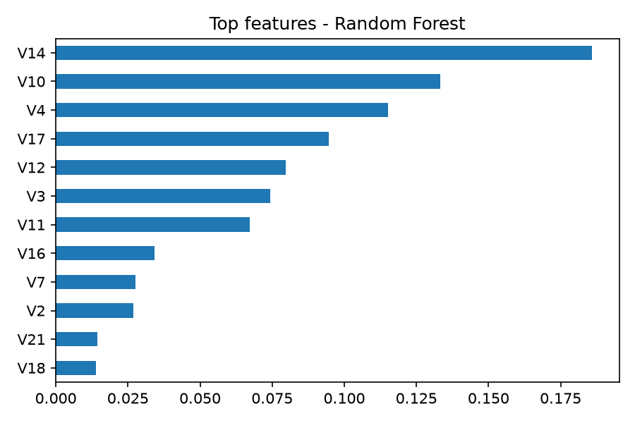

# Credit Card Fraud Detection: Data Pipeline + ML Model

End-to-end project: raw transaction data -> automated validation and cleaning -> database -> ML models -> Power BI dashboard.

## Business problem
Fraud is rare but costly. The goal is to flag likely fraudulent card transactions so an analyst team can review
the riskiest ones first, while keeping false alarms low enough to be workable.

## Data
Kaggle "Credit Card Fraud Detection" (ULB): 284,807 raw transactions, 492 frauds. After cleaning: 283,726 transactions, 473 frauds (0.167%).
Features V1-V28 are anonymised (PCA), plus Time, Amount and Class (1 = fraud).
Source: Worldline and ULB Machine Learning Group, CC BY 4.0.

## Pipeline (`pipeline.py`)
1. **Extract** the raw CSV.
2. **Validate** with 6 data-quality checks (schema, nulls, duplicates, negative amounts, invalid labels, negative time).
   Results are saved in the `data_quality_report` table on every run.
3. **Transform**: remove duplicates and invalid rows, add `hour_of_day` and `amount_band`.
4. **Load** into SQLite (default) or PostgreSQL (set `DB_URL`).
5. **Log** every step to `logs/pipeline.log`; the run fails loudly if anything breaks.

Data quality findings: 1,081 exact duplicate rows (0.38%) removed; no nulls, negative amounts or invalid labels.

## Model (`model.py`)
- Stratified 75/25 train-test split (keeps the fraud rate equal in both).
- Two models with class weights to handle imbalance: Logistic Regression and Random Forest.
- Evaluated with precision, recall, F1, ROC-AUC and **PR-AUC**. Accuracy is not used because a model that
  predicts "legit" every time would score ~99.8%.

| Model | Precision | Recall | F1 | PR-AUC |
|---|---|---|---|---|
| Logistic Regression | 0.054 | 0.890 | 0.102 | 0.684 |
| Random Forest | 0.871 | 0.746 | 0.804 | 0.809 |

## Key findings
- Random Forest caught 88 of 118 frauds in the test set, with 13 false alarms.
- Half of all fraud cases (238 of 473) are in the 0-10 amount band.
- Hours 2 and 4 of the dataset's time window had fraud rates of 1.45% and 1.04%, against a 0.167% average.
- Only 138 of 70,932 test transactions were rated Medium risk or above, so analyst workload stays small.

## Business recommendation
Send transactions the model rates High or Critical (fraud probability of 0.5 or more) to analyst review. In the test set this was 101 transactions, of which 88 were real fraud and 13 were false alarms. About 30 frauds were still missed, so lower-risk transactions should not be auto-approved. A real bank would tune the threshold to analyst capacity and the cost of a missed fraud. Only the 0.5 threshold was tested here.

## Dashboard
Power BI dashboard built on `predictions.csv` and the database tables: 






Live project page: https://akshatrastogi-analyst.github.io/fraud-detection-pipeline/

## How to run
```
pip install -r requirements.txt
# download creditcard.csv from Kaggle into data/
python pipeline.py
python model.py
```

## Limitations
Anonymised features limit explainability; model uses a fixed 0.5 threshold; no time-based validation or
concept-drift monitoring. Next steps: threshold tuning, gradient boosting, scheduled runs.
